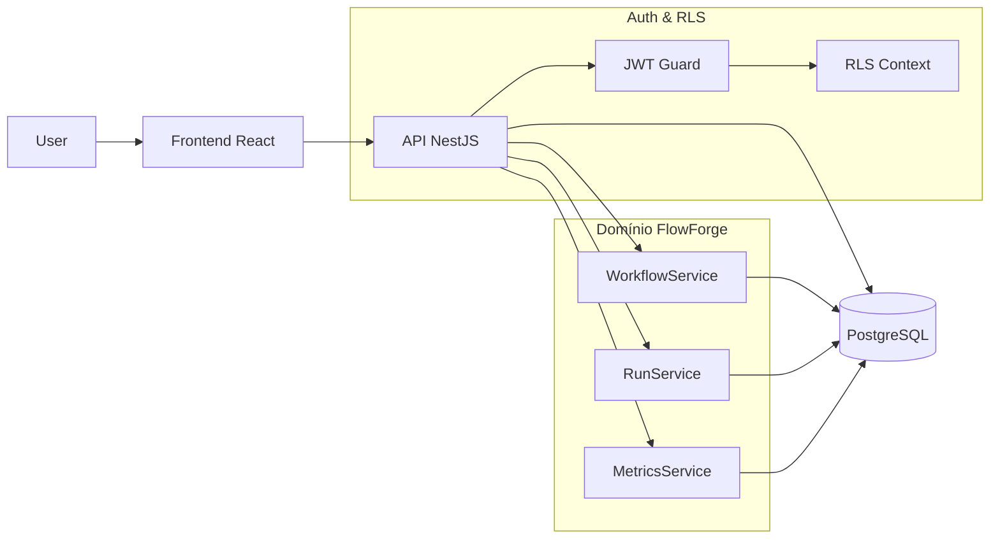

# Arquitetura do FlowForge

O FlowForge é composto por três grandes blocos: **frontend React**, **API NestJS** e **PostgreSQL com RLS**.

## Visão geral

## Banco de dados

- Tabelas principais:
  - `core_users`, `core_workspaces`, `core_workspace_members`
  - `flow_workflows`, `flow_workflow_steps`
  - `flow_workflow_runs`, `flow_workflow_run_steps`
  - `flow_events`
- Migrações em `db/migrations`:
  - `*_create_core_and_flow_tables.sql`
  - `*_add_rls_policies.sql`
- RLS baseada em:
  - Funções `app_current_user_id()` e `app_current_workspace_ids()`
  - Políticas que restringem acesso por `workspace_id`

## Backend (NestJS)

- Módulo raiz: `AppModule` agrega:
  - `AuthModule`
  - `UsersModule`
  - `WorkspacesModule`
  - `WorkflowsModule`
  - `RunsModule`
  - `MetricsModule`
- Autenticação:
  - JWT via `JwtStrategy` e `JwtAuthGuard`
  - Guard global configurado em `AppModule`

## Frontend (React)

- SPA criada com Vite + React + TypeScript.
- Rotas previstas:
  - Autenticação (login/registro)
  - Dashboard do workspace
  - Listagem e builder de workflows
  - Execuções (runs) e detalhes
- Uso de componentes de layout (sidebar, navbar, cards, tabelas) para um visual de dashboard moderno.

